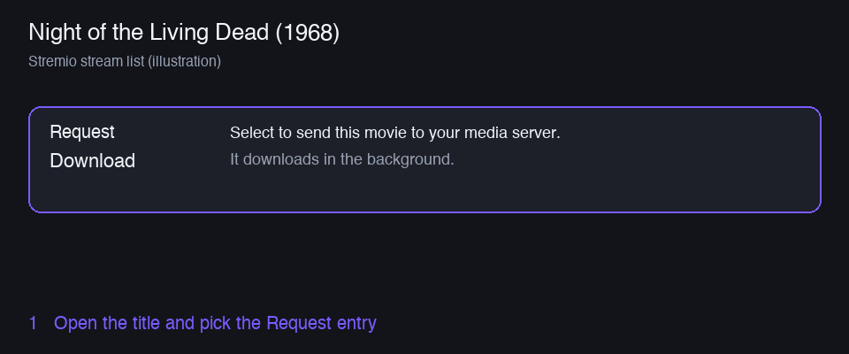

# Stremio Request Bridge

[](https://github.com/rafaellopes/stremio-request-bridge/actions/workflows/ci.yml)
[](LICENSE)

A Stremio addon that adds a **Request** entry to the stream list of any title you do not have yet. Select it and the title is sent to your own Radarr (movies) or Sonarr (seasons). The same entry then shows the download progress, so the whole cycle happens inside Stremio, with no extra app and no web page to open.



*Illustration of the states, not a screen recording.*

## Why

Stremio addons have no interface of their own. They can only answer "which streams exist for this title?". This project uses that one hook for a second job: one of the streams it returns is not a video, it is a button. Selecting it makes Stremio open a URL, and the URL triggers the request. [How it works](docs/how-it-works.md) explains the trick and the problems it brings.

It does not play anything. Pair it with the addon of your media server (for example Jellio, a Jellyfin plugin that exposes your library to Stremio) so the finished file appears in the same list.

## What you need

- Radarr and/or Sonarr already running and configured with a download client and indexers.
- Somewhere to run a small container (it has no dependencies and uses very little memory).
- An HTTPS address for it. Stremio on TVs and phones refuses plain http addons. A reverse proxy such as Caddy or nginx is enough.

## Quick start

1. **Get the files**

   ```bash
   git clone https://github.com/rafaellopes/stremio-request-bridge && cd stremio-request-bridge
   cp .env.example .env
   npm run gen-token        # prints a random secret, put it in ACCESS_TOKEN
   ```

2. **Edit `.env`.** The required values are `PUBLIC_URL`, `ACCESS_TOKEN` and the URL and API key of Radarr and/or Sonarr. Everything else has a default (see [Configuration](#configuration)).

3. **Start it**

   ```bash
   docker compose -f docker-compose.example.yml up -d
   ```

   Or without Docker: `node src/index.js` (Node 20 or newer, no `npm install` needed).

4. **Put HTTPS in front of it.** With Caddy, this is the whole config:

   ```
   request.example.com {
     reverse_proxy 127.0.0.1:7000
   }
   ```

   Set `TRUST_PROXY=true` so rate limits see the real client address.

5. **Install it in Stremio.** Open `web.stremio.com`, go to Addons, choose Add addon and paste:

   ```
   https://request.example.com/<ACCESS_TOKEN>/manifest.json
   ```

   Addons live in your Stremio account, so your TV and phone pick it up on their next start.

Open any title you do not have: a **Request** entry appears. Select it, wait for the 4 second notice, then reopen the title to watch the percentage.

## Configuration

All settings are environment variables. `.env.example` has the full list with comments.

| Variable | Default | Meaning |
|---|---|---|
| `PUBLIC_URL` | required | Address players use to reach the addon |
| `ACCESS_TOKEN` | required | Secret path segment, 16+ characters |
| `RADARR_URL`, `RADARR_API_KEY` | | Enables movies |
| `SONARR_URL`, `SONARR_API_KEY` | | Enables series (requests a whole season) |
| `RADARR_ROOT_FOLDER`, `SONARR_ROOT_FOLDER` | first one the app reports | Where new titles are stored |
| `RADARR_QUALITY_PROFILE`, `SONARR_QUALITY_PROFILE` | first one the app reports | Id or name of the profile |
| `LOCALE` | `en` | `en` or `pt` |
| `SOURCE_NAME` | `Request` | Left column of the stream entry |
| `RATE_LIMIT_PER_MINUTE` | `20` | Requests per client address, `0` disables |
| `GLOBAL_LIMIT_PER_HOUR` | `60` | Requests across all clients, `0` disables |

Tip: set the quality profile in Radarr/Sonarr with a size limit, so a request can never pick an enormous release.

## Security

The request URL is a plain `GET`, because that is all a player can call. That means anyone who knows the address can trigger requests, so:

- Every route except `/healthz` lives under `/<ACCESS_TOKEN>/`. A wrong token gets the same 404 as any unknown path. Treat the manifest URL like a password and do not share screenshots of it.
- Only a real `GET` triggers a request. `HEAD`, range requests and anything else get the notice video without side effects.
- Repeating the same request within 10 minutes does nothing (players often retry).
- Requests are rate limited per client and globally.
- Ids are validated before anything reaches Radarr/Sonarr.
- The container runs as a non-root user and holds the Radarr/Sonarr keys only in its environment.

The addon needs no access to your media files, only to the Radarr/Sonarr API.

## Limitations

- Movies and TV series that have an IMDb id (what Stremio uses). Series are requested one season at a time.
- Developed against Radarr v6 and Sonarr v4 (API v3). Other versions are untested.
- No web interface and no per-user permissions: whoever has the manifest URL can request.
- It reports progress from Radarr/Sonarr when the title page opens, it does not push updates.

## Related projects

[Jellyseerr / Seerr](https://github.com/Fallenbagel/jellyseerr) are full request managers with their own web app, accounts and approval flows. This is the opposite trade: no interface at all, the request button lives in Stremio.

## Responsible use

This project only talks to Radarr and Sonarr. What they download is decided by your own configuration, and you are responsible for making sure you are allowed to obtain and use that content. The examples here use public domain films.

## Development

```bash
npm test          # 30 tests, no dependencies, runs against in-memory Radarr/Sonarr mocks
npm run notices   # regenerate the notice videos (needs ffmpeg with drawtext)
```

The tests start the real HTTP server against small fake Radarr and Sonarr APIs, so they cover the request flow end to end.

## License

[MIT](LICENSE)
